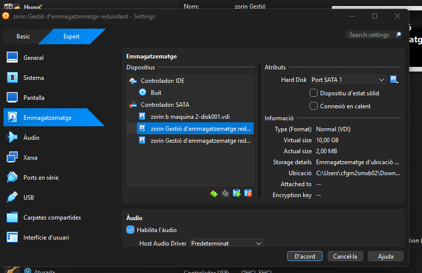
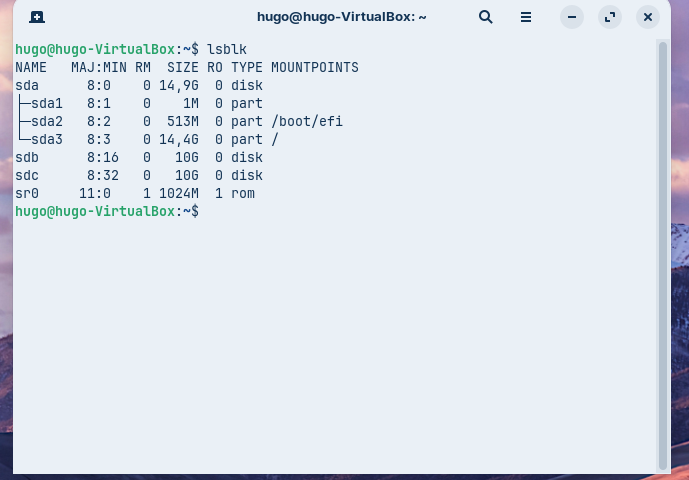
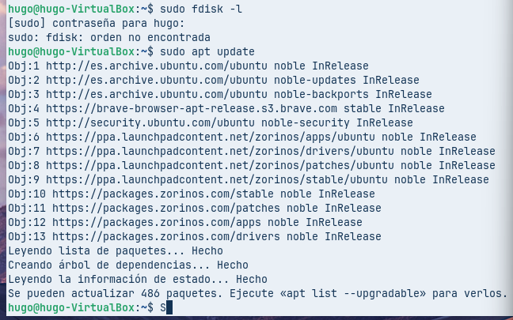
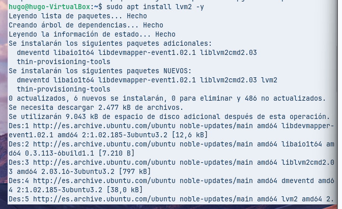
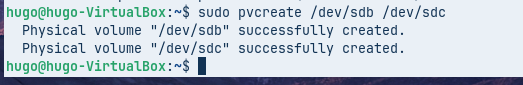
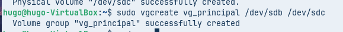
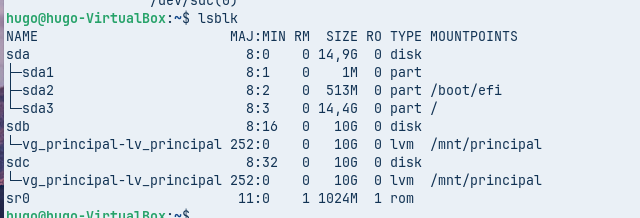

**Gestió d'emmagatzematge redundant** 

**Paso 1\. Preparar la máquina virtual** 

****

**Paso 2\. Comprobar els discos** 

****

**Paso 3\. Instalar LVM**   
****

****

**Paso 4\. Crear el grupo de volúmenes (VG)** 

****

****

![][image7]

**Paso 5\. Crear el volumen lógico (LV)**   
**![][image8]**

![][image9]

![][image10]

![][image11]

![][image12]

**Paso 6\. Configurar el montaje automático (/etc/fstab)** 

**![][image13]**

**![][image14]**

**![][image15]**

**Paso 7\. Crear un espejo (Mirror)** 

**![][image16]**

**![][image17]**

**![][image18]**

## **Paso 8\. Añadir dos discos nuevos para snapshots**

![][image20]

![][image21]  
![][image22]

**Paso 9\. Crear el volumen de datos** 

![][image23]  
![][image24]

![][image25]

![][image26]

**Paso 10\. Crear un snapshot** 

![][image27]

![][image28]

**![][image29]**  
**![][image30]**
