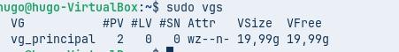
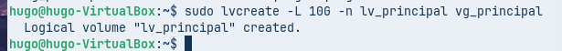
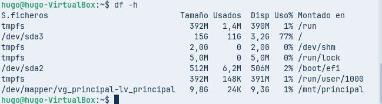
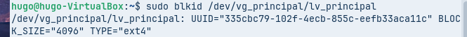
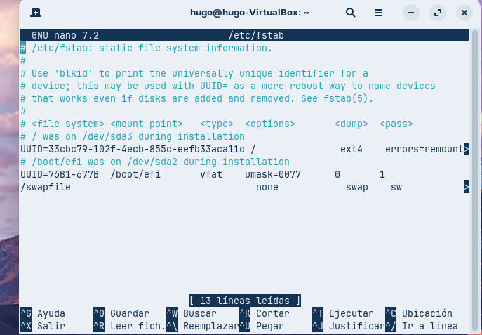
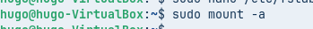
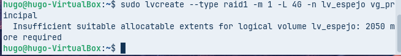
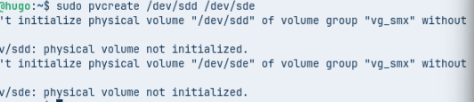
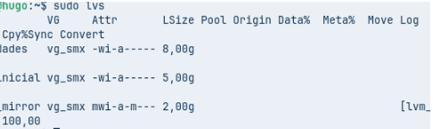
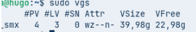

# Gestió d'emmagatzematge redundant 

### Paso 1\. Preparar la máquina virtual
Abans d'iniciar Zorin OS, apaga la màquina virtual.

A VirtualBox:
1. Selecciona la màquina virtual Zorin OS.
2. Entra a Configuració.
3. Ves a Emmagatzematge.
4. Afegeix dos discs durs virtuals.
5. Selecciona VDI.
6. Selecciona mida dinàmica.
7. Assigna 10 GB a cada disc.

### Paso 2\. Comprobar els discos
Un cop iniciat Zorin OS, hem obert el terminal i hem utilitzat l'ordre lsblk per comprovar que els dos discos nous estaven connectats correctament.

Aquesta ordre permet visualitzar els dispositius d'emmagatzematge del sistema.

### Paso 3\. Instalar LVM  
 Hem instal·lat el paquet LVM2 mitjançant el terminal. Aquesta eina permet agrupar diversos discos físics i gestionar l'espai d'emmagatzematge de manera flexible.

Ordres utilitzades:

sudo apt update

sudo apt install lvm2 -y

### Paso 4\. Creació del grup de volums (VG)
Hem preparat els dos discos físics per utilitzar-los amb LVM i posteriorment els hem agrupat en un únic grup de volums anomenat vg_principal.

Això permet gestionar l'espai dels dos discos com un conjunt.

Ordres utilitzades:

sudo pvcreate /dev/sdb /dev/sdc

sudo vgcreate vg_principal /dev/sdb /dev/sdc

sudo vgs

### Paso 5\. Creació del volum lògic (LV) 
Dins del grup de volums hem creat un volum lògic de 10 GB anomenat lv_principal.

Després l'hem formatat amb el sistema de fitxers ext4 i l'hem muntat a la carpeta /mnt/principal.

Ordres utilitzades:

sudo lvcreate -L 10G -n lv_principal vg_principal

sudo mkfs.ext4 /dev/vg_principal/lv_principal

sudo mkdir -p /mnt/principal

sudo mount /dev/vg_principal/lv_principal /mnt/principal

### Paso 6\. Configuració del muntatge automàtic (/etc/fstab)
Hem modificat el fitxer /etc/fstab per configurar el muntatge automàtic del volum lògic cada vegada que s'inicia el sistema.

Hem consultat l'UUID del volum i l'hem afegit al fitxer de configuració.

Ordres utilitzades:

sudo blkid /dev/vg_principal/lv_principal

sudo nano /etc/fstab

sudo mount -a

### Paso 7\. Configuració del mirall (Mirror) 
Hem creat un volum amb configuració RAID 1 per mantenir dues còpies de la informació en discos diferents.

Aquesta configuració proporciona redundància i permet continuar disposant de les dades si un dels discos falla.

Ordres utilitzades:

sudo lvcreate --type raid1 -m 1 -L 4G -n lv_espejo vg_principal

sudo lvs -a -o +devices

### Paso 8\. Ampliació del grup de volums
Hem afegit dos discos virtuals nous de 10 GB a la màquina virtual.

Després els hem preparat i incorporat al grup de volums existent mitjançant l'ordre vgextend.

Això permet disposar de més espai per crear nous volums lògics.

Ordres utilitzades:

sudo pvcreate /dev/sdd /dev/sde

sudo vgextend vg_principal /dev/sdd

sudo vgextend vg_principal /dev/sde

 

### Paso 9\. Creació del volum de dades
Hem creat un nou volum lògic anomenat lv_dades de 10 GB utilitzant el primer dels discos afegits.

Després l'hem formatat amb ext4 i l'hem muntat a /mnt/dades.

Finalment, hem creat un fitxer de prova per comprovar que el volum permet emmagatzemar informació.

Ordres utilitzades:

sudo lvcreate -L 10G -n lv_dades vg_principal /dev/sdd

sudo mkfs.ext4 /dev/vg_principal/lv_dades

sudo mkdir -p /mnt/dades

sudo mount /dev/vg_principal/lv_dades /mnt/dades

  

### Paso 10\. Creació d'una instantània (Snapshot)
Hem creat una instantània del volum lv_dades amb el nom lv_snapshot.

Aquesta instantània permet conservar l'estat del volum en un moment concret i facilita la recuperació de dades davant possibles modificacions o errors.

Ordres utilitzades:

sudo lvcreate -L 5G -s -n lv_snapshot vg_principal/lv_dades

sudo lvs

