# Gestió d'emmagatzematge redundant 

### Paso 1\. Preparar la máquina virtual

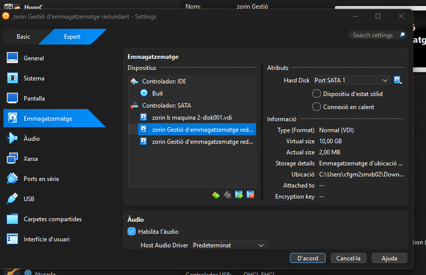

### Paso 2\. Comprobar els discos

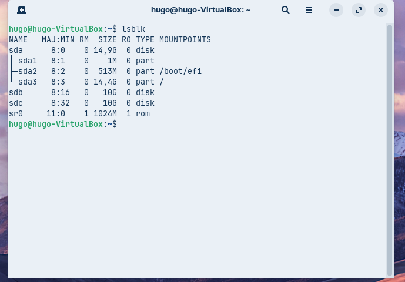

### Paso 3\. Instalar LVM   
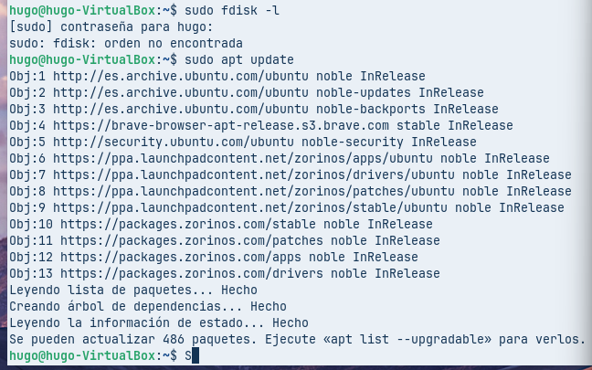

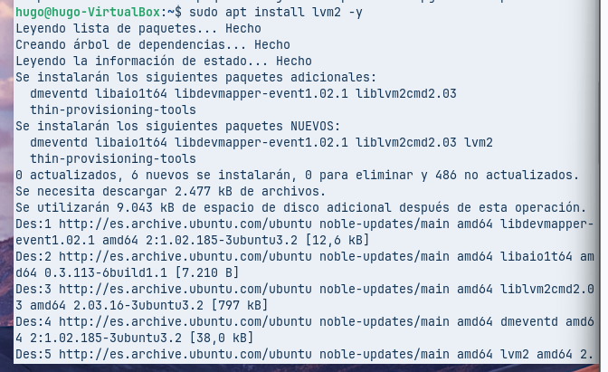

### Paso 4\. Crear el grupo de volúmenes (VG)

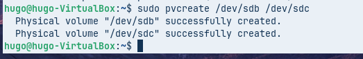

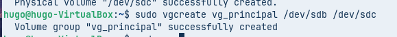

### 9 Paso 5\. Crear el volumen lógico (LV)   

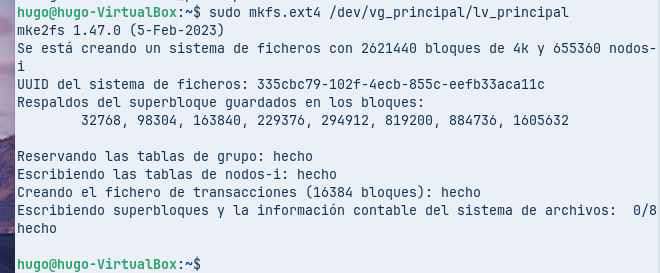

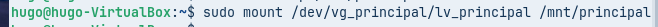

### Paso 6\. Configurar el montaje automático (/etc/fstab)

### Paso 7\. Crear un espejo (Mirror) 

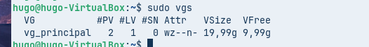

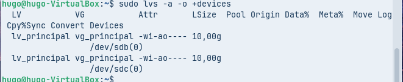

### Paso 8\. Añadir dos discos nuevos para snapshots

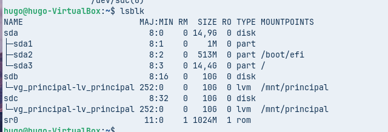

 

### Paso 9\. Crear el volumen de datos

  

### Paso 10\. Crear un snapshot

